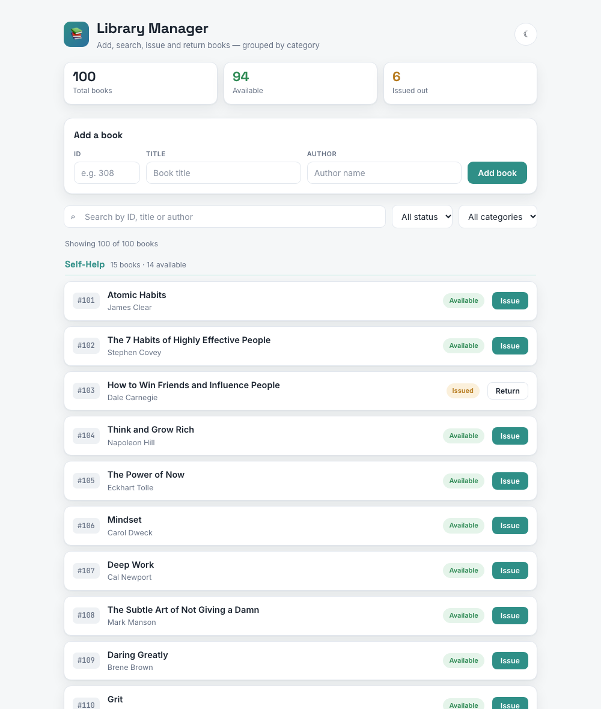

# Library Management System (C++)

A console-based **Library Management System** written in modern **C++17**, built
as the **Mini Project (Practical 12, Option A)** of the C++ Programming Practical
Manual. The repository also contains solutions to **Practicals 01–11**.

**Author:** Himesh Khatri
**Email:** Khatrihimesh2@gmail.com
**Phone:** +91 7248952059

---

## 🌐 Web version — open it in your browser

Prefer a visual, click-to-use version? [`library.html`](library.html) is a
**standalone web app** of the same system — it needs **no compiler and no
server**. It loads all **100 books grouped by category** and lets you add,
search, filter, issue and return books, saving your changes automatically in the
browser.



**How to open it**

- **Easiest:** double-click `library.html` in your file manager — it opens in
  your default browser.
- **Or** from a terminal in the project folder:

  | OS | Command |
  |----|---------|
  | macOS | `open library.html` |
  | Windows | `start library.html` |
  | Linux | `xdg-open library.html` |

Everything runs locally in the page; the sample catalogue mirrors the C++
program's `catalog.csv`, grouped by the same ID ranges (Self-Help, Space,
Biology, Physics, Chemistry, Mathematics, Other).

> The console C++ program below is the actual **mini-project submission**; the
> web page is an extra, friendlier way to try the same features.

---

## 1. What this project does

The application lets a librarian manage a catalogue of **100 sample books**
spread across seven fields (Self-Help, Space, Biology, Physics, Chemistry,
Mathematics and Other). A librarian can:

- **Add** a new book (unique ID, title, author)
- **List** every book, neatly **grouped by field**
- **Find** a book by typing *any* part of its ID, title or author
- **Issue** a book to a reader
- **Return** a book
- **Save** the catalogue to disk

All data lives in a CSV file (`catalog.csv`) that is **loaded automatically when
the program starts** and **saved automatically after every change**, so the
library remembers its state between runs.

---

## 2. How it works (architecture)

The program is split into small classes, each with one job:

| File | Responsibility |
|------|----------------|
| [`Book.h`](Book.h) / [`Book.cpp`](Book.cpp) | One book record. Holds ID, title, author, availability. Knows how to convert itself **to/from a CSV line**. |
| [`Library.h`](Library.h) / [`Library.cpp`](Library.cpp) | The whole catalogue. Stores books in an STL `std::map`, and provides add / issue / return / search / load / save. |
| [`LibraryExceptions.h`](LibraryExceptions.h) | A hierarchy of **custom exceptions** (`BookNotFound`, `DuplicateBookId`, `BookUnavailable`, `BookNotIssued`, `InvalidInput`, `MalformedRecord`). |
| [`main.cpp`](main.cpp) | The **menu loop** that reads the user's choice and calls the right `Library` method, wrapped in `try/catch`. |
| [`catalog.csv`](catalog.csv) | The saved data (100 books). |

### The flow of one run

```
            ┌──────────────────────────────────────────────┐
            │  main()                                       │
            │  1. Library lib("catalog.csv");               │
            │  2. lib.loadFromFile();  ← reads 100 books    │
            │  3. loop: show menu, read choice              │
            │       └─ call lib.addBook()/issueBook()/...   │
            │          wrapped in try { } catch { }         │
            │  4. on exit: lib.saveToFile();                │
            └──────────────────────────────────────────────┘
                              │ owns
                              ▼
            ┌──────────────────────────────────────────────┐
            │  Library   (std::map<int, Book>)              │
            │   addBook()      → throws DuplicateBookId     │
            │   issueBook()    → throws BookUnavailable     │
            │   returnBook()   → throws BookNotIssued       │
            │   search()       → returns std::vector<Book>  │
            │   load/saveFile()→ reads/writes catalog.csv   │
            └──────────────────────────────────────────────┘
                              │ stores many
                              ▼
                        ┌───────────┐
                        │   Book    │  id, title, author, available
                        └───────────┘
```

### Why each design choice

- **`std::map<int, Book>`** — books are keyed by ID, so looking up, issuing or
  returning a book by ID is fast, and the list always comes out sorted by ID
  (which keeps the field groups together).
- **Custom exceptions** — instead of returning error codes, each illegal action
  (issuing an issued book, unknown ID, …) *throws* a specific exception. `main()`
  catches them in one place and prints a friendly `[Error] …` message. The
  program never crashes on bad input.
- **CSV persistence** — a plain-text `id,title,author,available` format that is
  human-readable and easy to inspect. Malformed lines are skipped with a warning
  rather than crashing the load.
- **Automatic save** — every add/issue/return writes the file immediately, so
  data is never lost even if the program is closed abruptly.

---

## 3. Course concepts demonstrated

| Concept | Where it appears |
|---------|------------------|
| **Encapsulation (OOP)** | `Book`/`Library` keep data private, exposed via methods |
| **STL containers** | `std::map`, `std::vector`, `std::string` |
| **Inheritance & polymorphism** | exception hierarchy from `std::runtime_error` |
| **Exception handling** | custom exceptions thrown in `Library`, caught in `main` |
| **File I/O** | CSV load at startup, save on change (`fstream`) |

---

## 4. Build & run

### Using the Makefile (recommended)
```bash
make        # compiles to ./library
make run    # compiles (if needed) and runs
make clean  # removes build artifacts
```

### Manual compilation
```bash
g++ -std=c++17 -Wall -Wextra -O2 main.cpp Book.cpp Library.cpp -o library
./library
```

Requires a C++17 compiler (g++ 7+ or clang 5+).

---

## 5. Using the program

When it starts you see:

```
Loaded 100 book(s) from catalog.csv.

==============================================
        LIBRARY MANAGEMENT SYSTEM
==============================================
  1. Add a book
  2. List all books
  3. Find a book (by ID, title or author)
  4. Issue a book
  5. Return a book
  6. Save to file
  0. Save and exit
----------------------------------------------
```

### Option 2 — List all books (grouped by field)
```
  ==== Self-Help ====
  ID: 101   | Atomic Habits                  | James Clear            | Available
  ...
  ==== Space ====
  ID: 201   | Cosmos                         | Carl Sagan             | Available
  ...
  Total: 100 book(s).
```

### Option 3 — Find a book
Type anything you remember — it matches ID, title **or** author:
- `feynman` → all Feynman physics books
- `sagan`   → Carl Sagan's space books
- `2`       → everything whose ID contains "2"
- *(blank)* → show every book

### Options 4 & 5 — Issue / Return (with error handling)
```
  Choose an option: 4
  Enter ID of book to issue: 103
  [Error] Book "How to Win Friends and Influence People" is already issued out.

  Choose an option: 4
  Enter ID of book to issue: 999
  [Error] No book found with ID 999.
```
These are the **normal vs. error** cases required by the submission checklist.

---

## 6. Book catalogue (ID ranges by field)

| ID range | Field | Count |
|----------|-------|-------|
| 101–115 | Self-Help | 15 |
| 201–215 | Space | 15 |
| 301–314 | Biology | 14 |
| 401–414 | Physics | 14 |
| 501–514 | Chemistry | 14 |
| 601–614 | Mathematics | 14 |
| 701–714 | Other | 14 |

---

## 7. Data format (`catalog.csv`)

```
id,title,author,available
101,Atomic Habits,James Clear,1
```
`available` is `1` (on shelf) or `0` (issued). Lines that cannot be parsed are
skipped with a warning instead of crashing the program.

> **Tip:** if you open `catalog.csv` in an editor while the program runs and the
> editor asks to save it, choose **Revert**, not Save — otherwise the editor's
> old copy can overwrite the program's changes.

---

## 8. Repository layout

```
library_management_system/
├── Book.h / Book.cpp            # Book record + CSV serialization
├── Library.h / Library.cpp      # Catalogue management + persistence
├── LibraryExceptions.h          # Custom exception hierarchy
├── main.cpp                     # Console menu driver
├── catalog.csv                  # 100 sample books
├── Makefile                     # Build rules
├── library.html                 # Web version (open in a browser)
├── CPP_Practical_Manual.pdf     # Full practical manual (all 12 practicals)
├── diagrams/                    # SVG diagrams used in the manual
├── screenshots/                 # README images
├── UML.md                       # UML class diagram
├── README.md                    # This file
└── practicals/                  # Practicals 01–11 (see practicals/README.md)
    ├── 01_fundamentals/
    ├── 02_classes/
    ├── ...
    └── 11_file_io/
```

The [`practicals/`](practicals/) folder contains the 11 earlier practicals
(fundamentals, classes, Rule of Five, smart pointers, inheritance,
polymorphism, overloading, Factory pattern, templates, custom exceptions and
file I/O). See [`practicals/README.md`](practicals/README.md) for how to build
and run each one.

---

## 9. UML class diagram

See [`UML.md`](UML.md) for the full class diagram and relationships
(`Library ◆── Book` composition, and the `LibraryException` hierarchy).
